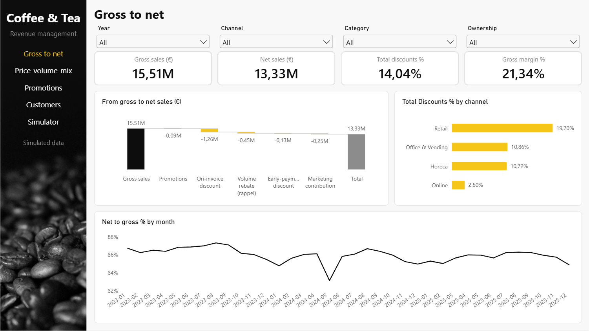
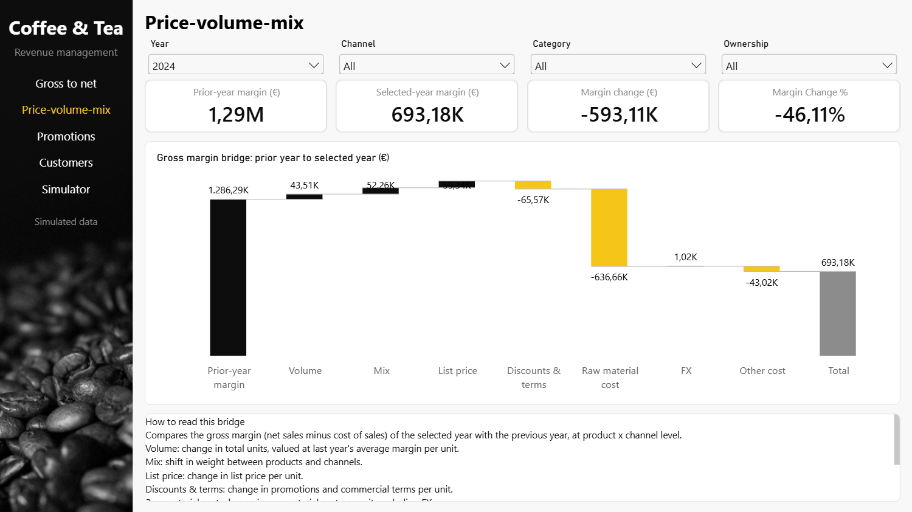
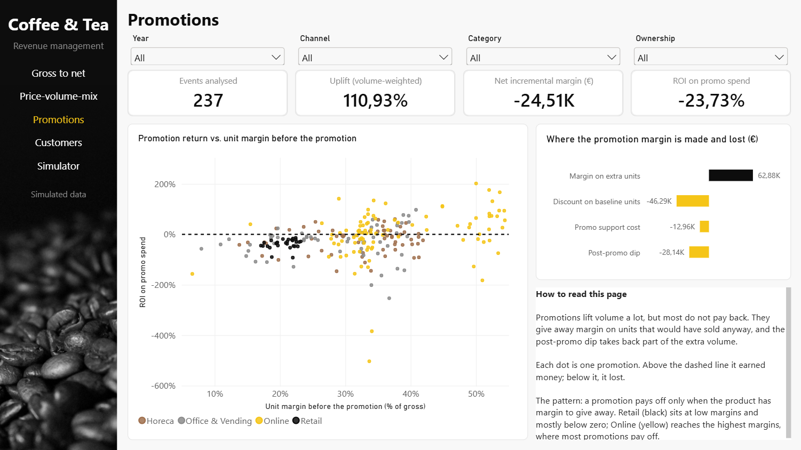
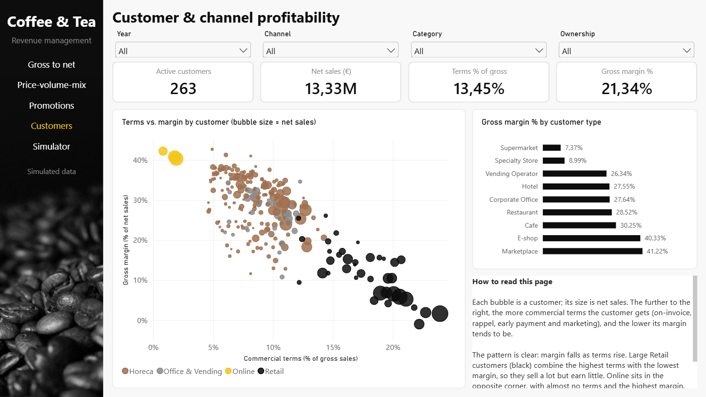
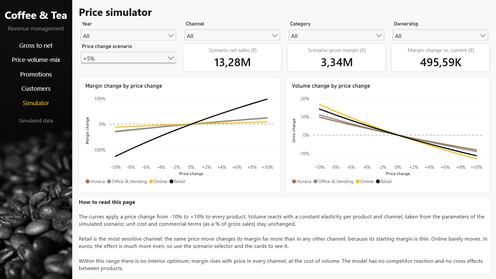

# Coffee & Tea — Revenue Management

Revenue management analysis for a fictional Catalan coffee and tea company, built on Microsoft Fabric and Power BI.

> **Simulated data.** All company, customer and transaction data in this project is simulated. Commodity prices and exchange rates come from public series (see Credits); everything else is generated.

## What this project is

The company sells its own brand (Mas Albera) and distributes five third-party brands (Brewlet, Casa Fulla, Tetera Alta, Dolçor and Cacau Nord) through four channels: Horeca, Retail, Office & Vending and Online.

The report answers one question: how does a list price turn into margin, and what moves it along the way? It covers the gross-to-net waterfall, price-volume-mix, promotions, customer profitability and a price simulator, over three years of weekly sales (2023 to 2025).

The report was built in a Microsoft Fabric workspace. The screenshots below show every page.

## Report pages

### 1. Gross to net

How gross sales (15,51M €) become net sales (13,33M €) after promotions, on-invoice discounts, volume rebates (rappel), early-payment discounts and marketing contributions. Total discounts are 14,04% of gross sales, from 19,70% in Retail to 2,50% in Online. The monthly net-to-gross line shows how stable that ratio is over time, with one sharp dip in 2024.

### 2. Price-volume-mix

A gross margin bridge from the prior year to the selected year, split into volume, mix, list price, discounts & terms, raw material cost, FX and other cost. It is calculated at product x channel level. With 2024 selected, margin falls from 1,29M € to 693,18K € (-46,11%), and raw material cost is the largest driver (-636,66K €).

### 3. Promotions

237 promotions analysed. Promotions lift volume (uplift of 110,93%), but they do not pay back on average: net incremental margin is -24,51K € and ROI on promotion spend is -23,73%. The scatter plot shows each promotion against the unit margin of the product before the promotion; a promotion tends to pay off only when the product has margin to give away. The bar chart splits the result into margin on extra units (+62,88K €), discount given on units that would have sold anyway (-46,29K €), promotion support cost (-12,96K €) and the post-promotion dip (-28,14K €).

### 4. Customer & channel profitability

263 active customers. Each bubble is a customer, sized by net sales: the more commercial terms a customer gets, the lower its margin. Large Retail customers combine the highest terms with the lowest margin, while Online sits at the opposite corner. Gross margin by customer type goes from 7,37% (Supermarket) to 41,22% (Marketplace).

### 5. Price simulator

Applies a price change from -10% to +10% to every product and shows the effect on margin and volume by channel. With the +5% scenario selected, gross margin changes by +495,59K € against the current situation. Retail is by far the most sensitive channel because its starting margin is thin.

## Data model

The data lives in a Fabric Lakehouse (silver layer for the real series, gold layer for the star schema) and is served through a Direct Lake semantic model.

- **Dimensions:** `dim_date` (weekly), `dim_month`, `dim_product`, `dim_channel`, `dim_customer`.
- **Facts:** `fact_sales`, `fact_price_list`, `fact_cost`, `fact_customer_terms`, `fact_promotion`, `fact_promo_performance`.
- **Helper tables without relationships**, used to drive visuals: `dim_waterfall_step`, `dim_pvm_step`, `dim_promo_step`, `dim_elasticity`, `dim_price_step`, `dim_price_scenario`.
- **Measures** are organised in display folders (base measures, price-volume-mix, promotions, price simulator).
- **Definitions:** gross margin is net sales minus cost of sales; gross margin % is calculated over net sales; terms % of gross is the commercial terms (everything except the promotion discount) over gross sales.

The report uses a fixed colour for each channel on every page: Retail black, Online yellow, Horeca coffee brown and Office & Vending grey.

## How the data is built

Two Python notebooks in Fabric build everything.

- **`nb_01_real_series`** loads the public series (commodity prices and EUR exchange rates) into the silver layer.
- **`nb_02_data_generation`** generates the company: products, channels, customers, price lists, unit costs built from the real commodity series, commercial terms per customer, promotions and weekly sales.

How the simulation works:

- Volume reacts to price with a constant elasticity per category, ownership and channel.
- Promotions are only planned on product-channel pairs with a unit margin of at least 20%, and the discount never exceeds half of that margin. Online follows a calendar (Black Friday, January Sales, Summer Sales); the other channels have their own events. 240 promotions are generated.
- The promotion uplift depends on the discount and the product elasticity, with an extra uplift when there is visibility support. After a promotion there is a dip in demand over three weeks. Promotion support cost is 3% of promoted gross sales.
- The promotion analysis is then done the way an analyst would on real data: the baseline is the average weekly units over the four weeks before the promotion (skipping weeks affected by other promotions or by a dip), and ROI is the net incremental margin divided by the discount plus support cost.

## Limitations

- The simulator assumes constant price elasticity per product and channel, with no competitor reaction, no cross-effects between products and unchanged unit cost. Within ±10% price change this produces no interior optimum: margin rises with price in every channel. The elasticities are the parameters of the simulated scenario; in a real company they would be estimated from price history.
- The promotion baseline method does not control for seasonality, so the estimates for Black Friday and January are biased. 3 promotions have no baseline and are excluded; 29 have fewer than four baseline weeks. Eligibility used the average margin over 36 months, so some promoted events had a real margin as low as 6,58% at the time.
- The post-promotion dip has a floor (the demand multiplier never goes below 0,3), which applies to 0,4% of the dip weeks.
- Distributed brands earn a very thin margin overall (1,48% of gross sales), and cocoa-based distributed products have a negative margin on purpose, as a stress test.
- Online has only 3 customers, and only one customer has a negative margin.
- The price-volume-mix bridge uses an approximation for FX on distributed brands.
- The date table is weekly, so it cannot be marked as a date table in the model.
- The report uses the Space Grotesk and Inter fonts, which are not embedded; viewers without them see a fallback font.
- Number formats in tooltips, text boxes and PDF exports follow the viewer's locale and may show English formatting.

## Repository

- `fabric/` — Fabric workspace items (notebooks, Lakehouse, semantic model and report), synced with Fabric Git integration.
- `docs/images/` — screenshots of the report pages.

## Credits

- Commodity prices: World Bank Commodity Price Data (The Pink Sheet).
- Exchange rates: source ECB statistics, used for information only. EUR values derived from these series are my own calculation.
- Background image: photo by Jasmijn van der Maaten on Pexels.